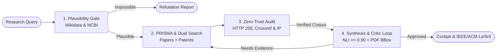

<div align="center">

# 🔬 VERITAS
### **Verified Evidence-Based Research, IP & Autonomous Synthesis System**

[](LICENSE)
[](https://python.org)
[](https://fastapi.tiangolo.com)
[](https://nextjs.org)
[](https://langchain-ai.github.io/langgraph/)
[](CONTRIBUTING.md)

*An open-source, closed-loop multi-agent AI research platform engineered to eliminate scientific hallucinations.*

[Why VERITAS](#-why-veritas) · [Workflow](#-how-it-works-simple-workflow) · [Key Features](#-key-features) · [Documentation](#-documentation) · [Team](#-core-team) · [Getting Started](#️-getting-started)

</div>

---

VERITAS pairs automated **PRISMA 2020** systematic review protocols with **dual academic + patent discovery** and **zero-trust source verification**. Every claim is grounded in exact PDF passages, checked against official registries (Crossref, PubMed, USPTO), and validated with live HTTP 200 checks before reaching the final output.

---

## ⚡ Why VERITAS?

| Traditional AI Assistants | 🛡️ The VERITAS Approach |
| :--- | :--- |
| **Premise Gullibility:** Summarizes impossible queries uncritically | **Ontological Gatekeeper:** Intercepts contradictions via Wikidata & NCBI Taxonomy |
| **Fabricated Citations & 404s:** Invents fake DOIs and dead links | **Zero-Trust Auditor:** Purges any source failing HTTP 200 or Crossref matching |
| **Ad-Hoc RAG:** No formal screening or exclusion audit trail | **PRISMA 2020 Engine:** 4-stage Identification → Screening → Eligibility → Included funnel |
| **Siloed Literature:** Ignores commercial patent prior art | **Dual Discovery:** Queries arXiv, S2AG & PubMed alongside USPTO & Google Patents |

---

## 🔄 How It Works (Simple Workflow)



> **Want the full technical diagrams?** See [Workflow & Sequence Diagrams](docs/03-WORKFLOW-DIAGRAMS.md), [UML & DFD Diagrams](docs/09-UML-AND-DFD-DIAGRAMS.md), or browse the exported PNG/SVG assets in [`docs/diagrams/`](docs/diagrams/).

---

## 🚀 Key Features

- 🧠 **Ontological Plausibility Gatekeeper** — Screens prompts against Wikidata SPARQL and NCBI Taxonomy before spending retrieval budget.
- 📋 **PRISMA 2020 Systematic Review Engine** — Generates Boolean query matrices, enforces inclusion/exclusion rules, and logs a full 4-stage audit trail.
- 🌐 **Dual Literature & Patent Landscaping** — Searches scholarly indices (arXiv, Semantic Scholar, PubMed, Crossref) concurrently with USPTO PatentsView and Google Patents.
- 🔒 **Zero-Trust Link & IP Verifier** — Runs asynchronous `aiohttp` HTTP 200 checks, Crossref metadata matching, license tagging, and fair-use overlap checks.
- 🎛️ **Interactive Research Cockpit** — Next.js 14 interface with live SSE agent telemetry, a split-pane PDF provenance highlighter (`bbox`), and a D3.js citation network.
- 📑 **One-Click Publication Export** — Packages verified surveys into IEEE and ACM LaTeX archives with validated `.bib` bibliographies.

---

## 📚 Documentation

> [!NOTE]
> **Project Status (Pre-Implementation):** All product, technical, API, UI/UX, security, and evaluation specs are complete in [`docs/`](docs/README.md). Code scaffolding (`backend/` and `frontend/`) begins in Phase 0 of the [Execution Plan](docs/05-EXECUTION-PLAN.md).

| Document | Focus |
| :--- | :--- |
| [**Documentation Index**](docs/README.md) | Overview and recommended reading order |
| [**01 · Product Requirements (PRD)**](docs/01-PRD.md) | Personas, `FR-1`–`FR-8`, `NFR`s, KPIs, and MVP vs. v1.0 scope |
| [**02 · Technical Requirements (TRD)**](docs/02-TRD.md) | 4-tier architecture, 8-agent specs, capability router, and NLI/model routing |
| [**03 · Workflow Diagrams**](docs/03-WORKFLOW-DIAGRAMS.md) | LangGraph StateGraph, SSE sequence, PRISMA funnel, and verification flows |
| [**04 · API & Data Contracts**](docs/04-API-AND-DATA-CONTRACTS.md) | REST endpoints, SSE events, Pydantic schemas, LangGraph state, and DB schema |
| [**05 · Execution Plan**](docs/05-EXECUTION-PLAN.md) | Phased roadmap, 6-month milestone alignment, and team ownership |
| [**06 · UI/UX Specification**](docs/06-UI-UX-SPEC.md) | Next.js 14 Cockpit screens, split-pane PDF provenance, and D3.js graph |
| [**07 · Test & Evaluation Plan**](docs/07-TEST-AND-EVAL-PLAN.md) | CI gates, adversarial plausibility suite, link integrity, and RAGAS targets |
| [**08 · Security & ADRs**](docs/08-SECURITY-AND-ADRS.md) | SSRF, prompt-injection, safe LaTeX guardrails, and architecture decisions |
| [**09 · UML & DFD Diagrams**](docs/09-UML-AND-DFD-DIAGRAMS.md) | DFD Level 0 & 1, State Machine, Class Diagram, and ER Diagram |
| [**`docs/diagrams/`**](docs/diagrams/) | Exported high-res `.png` and vector `.svg` files for all 10 diagrams |

---

## 💻 Tech Stack

| Layer | Technologies |
| :--- | :--- |
| **Frontend Cockpit** | Next.js 14 (App Router), React 18, TypeScript, TailwindCSS, Radix UI, D3.js, SSE |
| **Backend & Orchestration** | FastAPI, Python 3.10+, Pydantic v2, LangGraph (`StateGraph`), Celery, Redis |
| **Retrieval & Verification** | ChromaDB, BM25, Sentence-Transformers, PyMuPDF (`fitz`), NetworkX, `aiohttp`, Crossref API |
| **Connectors & Export** | arXiv, Semantic Scholar, PubMed, USPTO PatentsView, Google Patents, IEEE/ACM LaTeX |

---

## 👥 Core Team

Built and maintained by **Code Blooded**:

| Contributor | Role | Core Focus |
| :--- | :--- | :--- |
| **Pritam Jana** | Project Lead & Agent Architect | LangGraph Cyclical Orchestration, State Machines & Critic Loops |
| **Sachin Kumar Singh** | Full-Stack & Interface Lead | Next.js Research Cockpit, Graph Telemetry & Real-Time UX |
| **Rohit Kumar Ojha** | Data Ingestion & Pipeline Lead | Academic Ingestion APIs, Patent Connectors & PDF Parsers |
| **Sagar Jha** | Review Protocol Lead | PRISMA 2020 Review Engine & Ontological Gatekeeper |
| **Bhaskar Raj** | Verification & Export Lead | Live Link Auditor, IP Copyright Engine & LaTeX Compiler |

---

## 🛠️ Getting Started

### Prerequisites
- Python 3.10+
- Node.js 18+ & npm / pnpm
- Redis (for job queueing, caching, and SSE telemetry)

### 1. Clone the Repository
```bash
git clone https://github.com/Code-Blooded-CS/VERITAS.git
cd VERITAS
```

### 2. Backend Setup *(available after Phase 0 scaffolding)*
```bash
cd backend
python -m venv venv
# Windows: .\venv\Scripts\activate  |  Linux/macOS: source venv/bin/activate
pip install -r requirements.txt
uvicorn app.main:app --reload --port 8000
```

### 3. Frontend Setup *(available after Phase 0 scaffolding)*
```bash
cd ../frontend
npm install
npm run dev
```

Open [http://localhost:3000](http://localhost:3000) to access the VERITAS Research Cockpit.

---

## 🌿 Contributing & License

We follow trunk-based development with feature branches (`feature/<module>-<desc>`) and peer-reviewed PRs. See [CONTRIBUTING.md](CONTRIBUTING.md) for guidelines.

Licensed under the **MIT License** — see [LICENSE](LICENSE) for details.
