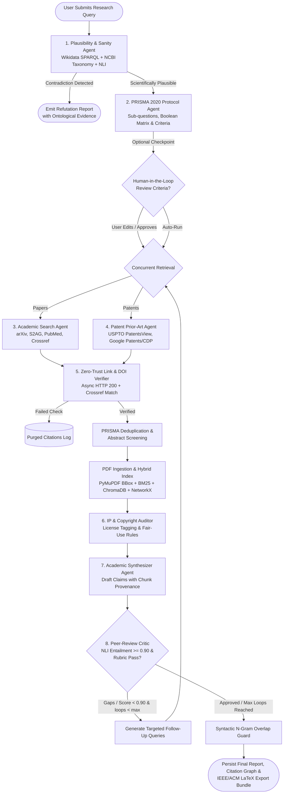
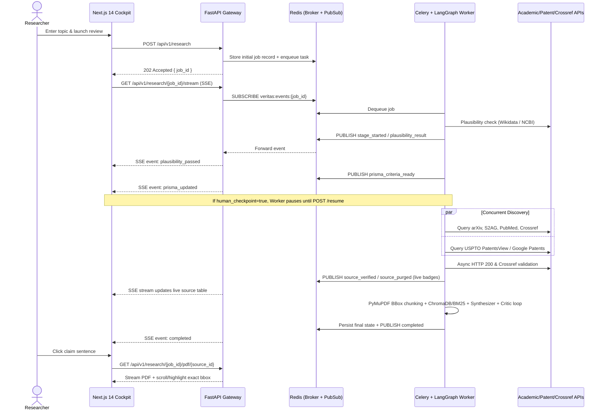
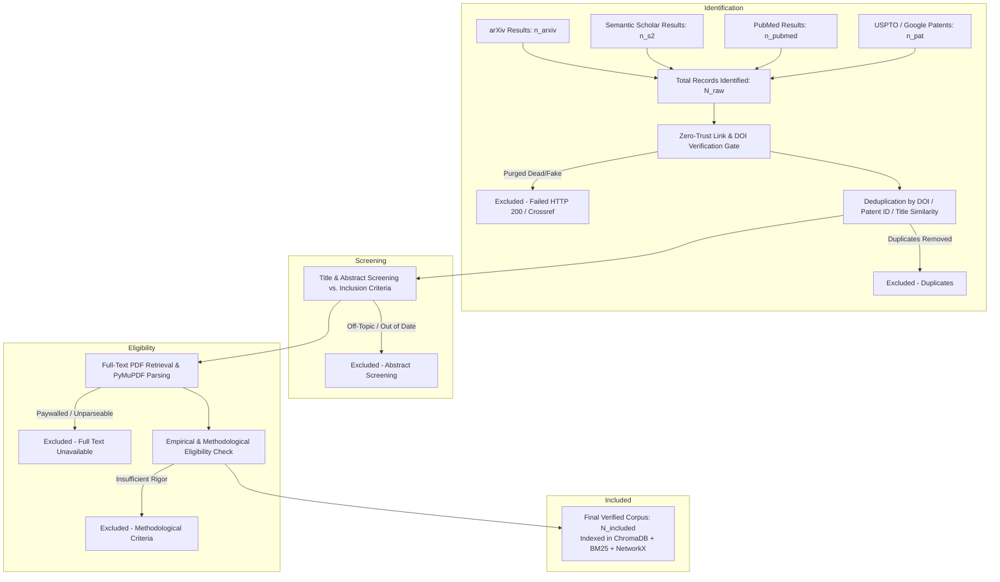
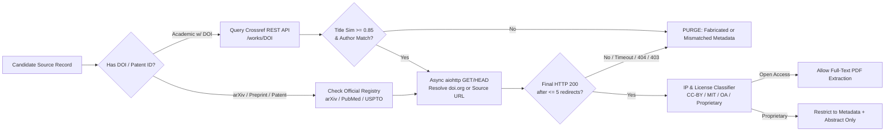
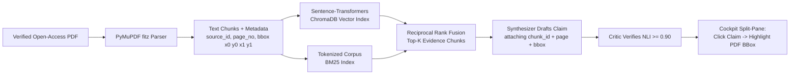

# VERITAS Workflow & Architecture Diagrams

This document defines the canonical system flows before implementation. All agent transitions, data flows, and UI synchronization protocols adhere to these diagrams.

---

## 1. End-to-End Multi-Agent LangGraph StateGraph

---

## 2. Real-Time Platform Sequence Diagram (Cockpit ↔ Backend ↔ Worker)

---

## 3. PRISMA 2020 4-Stage Screening & Deduplication Funnel

---

## 4. Zero-Trust Link, DOI & IP Verification Pipeline

---

## 5. Document Ingestion & Claim Provenance Binding

