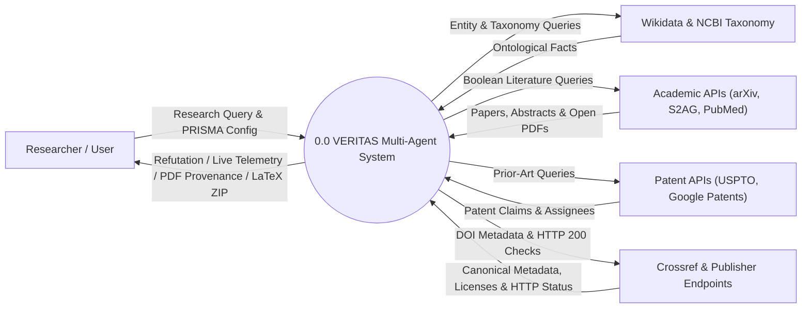
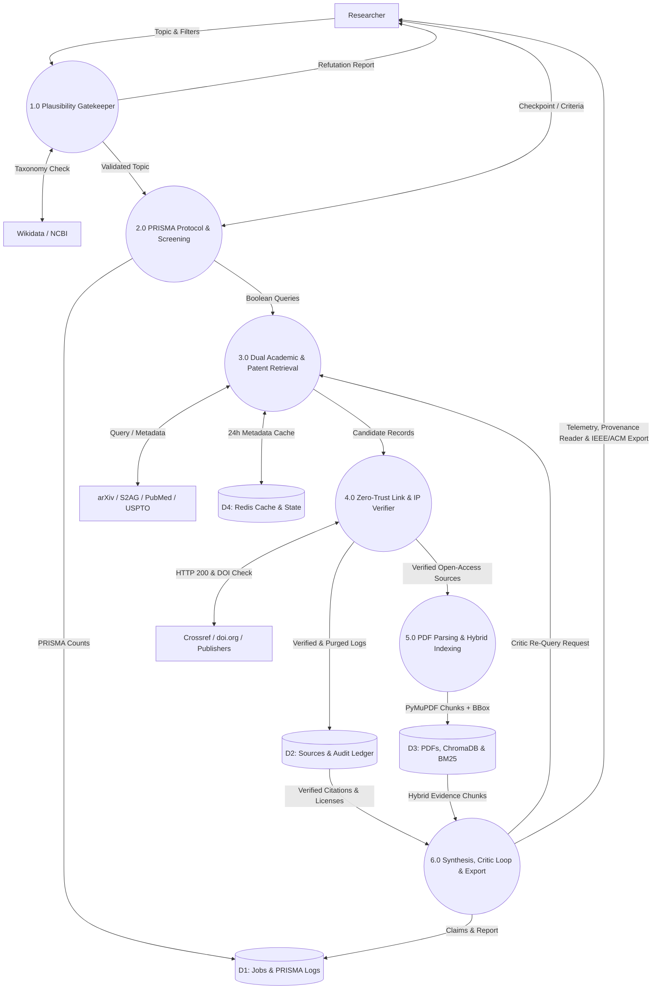
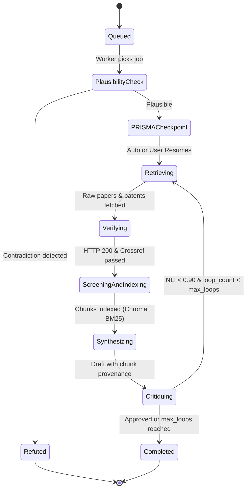
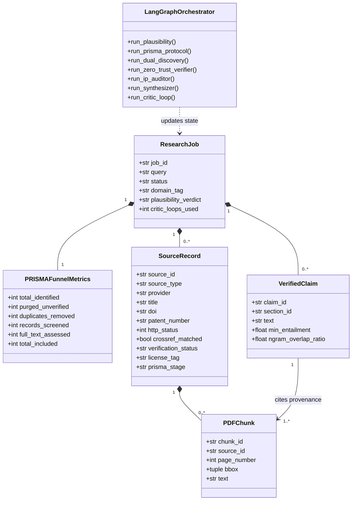
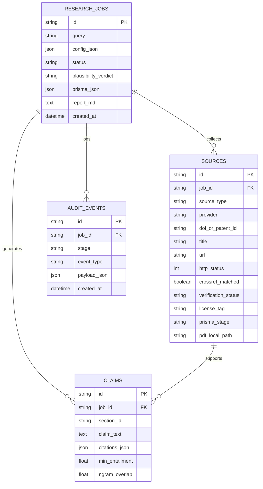

# UML & Data Flow Diagrams (DFD): VERITAS

> **Purpose:** Academic and software-engineering design diagrams prepared for project guide reviews, SRS/design checkpoints, and dissertation documentation.  
> **Companion Workflow & Sequence Diagrams:** See [03-WORKFLOW-DIAGRAMS.md](./03-WORKFLOW-DIAGRAMS.md) for the End-to-End LangGraph Flowchart, Runtime Sequence Diagram, PRISMA Funnel, Link/IP Verification Gate, and Ingestion Pipeline.

---

## 1. Data Flow Diagram — Level 0 (Context Diagram)

Shows VERITAS as a single system interacting with the Researcher and external scientific/IP registries.

---

## 2. Data Flow Diagram — Level 1

Decomposes `0.0 VERITAS` into six core processes and four persistent/cached data stores (`D1`–`D4`).

---

## 3. State Machine Diagram (`stateDiagram-v2`)

Models the LangGraph job lifecycle, human-in-the-loop PRISMA checkpoint, and bounded Critic reflection loop.

---

## 4. Class Diagram (`classDiagram`)

Represents the core domain models and multi-agent orchestrator defined in [04-API-AND-DATA-CONTRACTS.md](./04-API-AND-DATA-CONTRACTS.md).

---

## 5. Entity-Relationship Diagram (`erDiagram`)

Maps the relational database schema (`research_jobs`, `sources`, `claims`, `audit_events`) used by SQLite (dev) and PostgreSQL (production).

